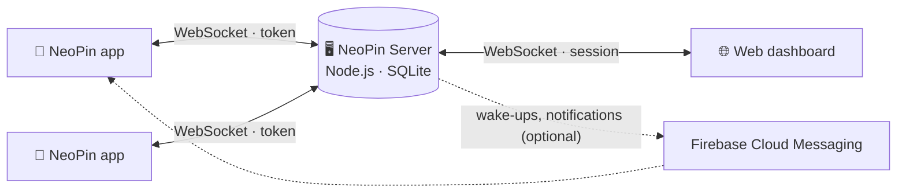
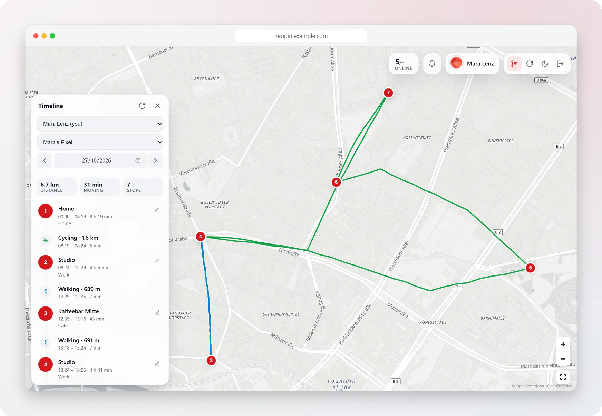

<div align="center">

<picture>
  <source media="(prefers-color-scheme: dark)" srcset=".github/assets/wordmark-dark.svg">
  
</picture>

Location sharing for family and friends, on a server you run yourself.

[](#2-run-the-app)
[&replace=%241&label=Expo%20SDK&color=000020&style=flat-square&logo=expo&logoColor=white)](https://expo.dev)
[&replace=%241&label=React%20Native&color=087ea4&style=flat-square&logo=react&logoColor=white)](https://reactnative.dev)
[%22&replace=%241&label=app&color=d3171e&style=flat-square)](app.config.js)
[](https://github.com/vxnsin/NeoPin/tree/Server)
[](LICENSE)

[**Server**](https://github.com/vxnsin/NeoPin/tree/Server) · [**Quick start**](#quick-start) · [**How it works**](#how-it-works) · [**Build**](#build-the-app) · [**Push**](#push-notifications-android) · [**Server docs**](https://github.com/vxnsin/NeoPin/blob/Server/README.md)

<br>

<picture>
  <source media="(prefers-color-scheme: dark)" srcset=".github/assets/map-dark.webp">
  
</picture>

</div>

<br>

NeoPin shows where your people are, like Find My or Google's location sharing, except that the positions go to a small server of your own and nowhere else. Everyone gets an account, groups decide who sees whom, and the phones and the web dashboard all draw the same live map.

The app is the phone half. It reports where you are, in the background too, and shows everyone you share a group with as a round picture or their initials: green while they report, yellow when the last position is getting old, grey when they are offline, with the battery next to each device. Tap someone to ask their phone for a fresh fix, or ask to find them. Once they say yes, you both see each other move live for half an hour, with an arrow on the lock screen and Bluetooth telling you when the last few metres are left.

## How it works



The app signs in once with a username and password and gets a device token. From then on it keeps a WebSocket open and sends its position whenever it moves; fixes taken without a connection follow later in one batch, so the history has no holes. The server keeps the live map in memory, stores the history in SQLite and pushes every change to the phones and dashboards that may see it.

On Android a foreground service keeps reporting while the app is closed, on iOS the system wakes a background location task on movement. How often is up to you: Battery saver (every 2 minutes or 100 m), Balanced (15 s or 10 m) or Precise. Maps are vector tiles from [OpenFreeMap](https://openfreemap.org) on MapLibre, light or dark with the system.

### Your days, afterwards

<picture>
  <source media="(prefers-color-scheme: dark)" srcset=".github/assets/timeline-dark.webp">
  
</picture>

From the stored positions the server builds a timeline, much like Google's: where you stayed and how you got from one place to the next, on foot, by bike, by car, or by bus, tram and train where timetable data covers your area. Name a place once and it is recognised from then on; a stop that was none can be dismissed and a wrong mode corrected. Your timeline is private until you share it with a group or with chosen people. Your places can also tell others when you arrive or leave.

<picture>
  <source media="(prefers-color-scheme: dark)" srcset=".github/assets/review-dark.webp">
  
</picture>

Every Monday, and on the first of a month, the review adds it up: kilometres, time on the move, the places you spent the most time at and the lines you rode most.

> [!NOTE]
> Positions stay on your server. Place names, timetables and smoother paths come from public services (Overpass, Photon, GTFS feeds, OSRM) that each see only what they need, and each of them can be pointed at your own instance or switched off. The [server configuration](https://github.com/vxnsin/NeoPin/blob/Server/README.md#configuration) says what each one sees.

## Repository layout

The app and the server live in the same repository on different branches.

| Branch / tag | Contents |
|:--|:--|
| **`main`** | The React Native / Expo app. You are here. |
| [**`Server`**](https://github.com/vxnsin/NeoPin/tree/Server) | Node.js server with the web dashboard and its own [README](https://github.com/vxnsin/NeoPin/blob/Server/README.md). Server releases are tagged there and published as a Docker image. |
| `archive/flutter` (tag) | The original Flutter app before the React Native rewrite. |

## Quick start

### 1. Run the server

The quickest way is the Docker image:

```bash
docker run -d --name neopin -p 3012:3012 -v neopin-data:/app/data --restart unless-stopped \
  ghcr.io/vxnsin/neopin-server:latest
docker logs neopin
```

The first start creates the admin account and prints its generated password once in the log. Open `http://<your-ip>:3012`, log in, and a short setup asks for your own password and a first group. Node without Docker, Compose, HTTPS and every setting are in the [server README](https://github.com/vxnsin/NeoPin/blob/Server/README.md#quick-start).

### 2. Run the app

```bash
git clone https://github.com/vxnsin/NeoPin.git
cd NeoPin
npm install
npx expo run:android   # or: npx expo run:ios
```

The app has native parts (background location, push, the lock screen view and Bluetooth during a find), so Expo Go won't do: you need a development build.

### 3. Sign in

Enter the server address (`192.168.1.20:3012` at home, `neopin.example.com` behind HTTPS) and the username and password the admin made for you. Or sign up with an invite code: anyone on the server can create one in the app or the dashboard, and the invite link opens the app with the code and the server already filled in.

Allow location access “all the time”, otherwise reporting stops as soon as the screen locks. A short tour shows the controls on the first start.

> [!WARNING]
> Plain `ws://` is fine at home. Over the internet, put the server behind HTTPS and connect with its host name, otherwise passwords, tokens and every position travel unencrypted.

## Build the app

Builds are configured in `eas.json`.

| Profile | Command | Output |
|:--|:--|:--|
| `development` | `eas build --profile development` | Dev client for local testing |
| `preview` | `eas build --profile preview --platform android` | Installable APK |
| `production` | `eas build --profile production` | Store build, the build number goes up by itself |

JavaScript changes reach installed apps with EAS Update, no new build needed. Native changes (a new module, a permission, Firebase) need a new build.

## Push notifications (Android)

Push uses Firebase Cloud Messaging. It wakes a phone without a connection when someone asks for its position or wants to find that person, and it delivers group invitations, arrival alerts, ride questions and the review. Without the Firebase config the app builds and runs as before, it just gets no push.

1. Create a project in the [Firebase console](https://console.firebase.google.com) and add an Android app with the package name `de.vensin.neopin`.
2. Download `google-services.json` and either put it into the `app/` folder (it stays out of git, `.easignore` does not exclude it so EAS Build uploads it), or store it as an EAS file secret named `GOOGLE_SERVICES_JSON`.
3. Give the server the service account key of the same project ([server docs](https://github.com/vxnsin/NeoPin/blob/Server/README.md#push-notifications)), it sends the messages.
4. Build a new APK. Push needs the native Firebase setup, an EAS Update alone is not enough.

The server has to report `push: true` in `GET /api/status`, otherwise the app does not send its token.

## Reference

<details>
<summary><b>Protocol</b></summary>
<br>

The app gets its token from `POST /api/auth/login` (`{ username, password, deviceId, deviceType }`), then opens a WebSocket and sends JSON. The full protocol and every HTTP route are in the [server README](https://github.com/vxnsin/NeoPin/blob/Server/README.md#websocket-protocol).

| App → Server | Purpose |
|:--|:--|
| `{ "type": "authenticate", "deviceId", "token", "deviceType"? }` | Log in. The server answers `{ "successful": true, "features": [...] }` or closes with code `4000` |
| `{ "type": "updatePosition", "latitude", "longitude", "battery"? }` | The own position, with the battery as `{ level, charging }` |
| `{ "type": "positionBatch", "points": [...] }` | Up to 100 fixes taken while there was no connection, each with `recordedAt` |
| `{ "type": "updateBattery", "level", "charging" }` | Only the battery changed |
| `{ "type": "pingDevices" }` | Ask every other visible device for a fresh position |
| `{ "type": "findRequest" \| "findAnswer" \| "findPosition" \| "findEnd", ... }` | Ask to find someone, answer, share the live position, stop |
| `{ "type": "ping" }` | Keep-alive, answered with `pong` |

| Server → App | Purpose |
|:--|:--|
| `{ "type": "dataResponse", "devices": [...] }` | Every device you may see, pushed on every change |
| `{ "type": "requestLocation" }` | Send an `updatePosition` now |
| `{ "type": "findRequest" \| "findPending" \| "findStarted" \| "findPosition" \| "findEnded", ... }` | The other side of a find |
| `{ "type": "rideQuestion", "rideId", "transit", "at" }` | “Are you on this line?”, answered over HTTP |
| `{ "type": "notificationsChanged" }` | New notifications to fetch |

</details>

<details>
<summary><b>App structure</b></summary>
<br>

```
app/
├─ _layout.tsx        socket provider, position reporting, background service
├─ index.tsx          start screen, then auto-connect
├─ login.tsx          server address, sign-in, sign-up with an invite code
├─ invite.tsx         opened by invite links
├─ map.tsx            map, people sheet, settings, timeline, find
└─ review.tsx         weekly and monthly review
components/           sheets and panels: timeline, groups, alerts, find, tour, ...
lib/
├─ SocketClient.ts    reconnecting WebSocket client with heartbeat and queue
├─ socket.ts          the one shared client and the stored credentials
├─ api.ts             HTTP calls with the device token
├─ mapHtml.ts         the MapLibre page inside the WebView
├─ timeline.ts        stays and trips as the timeline shows them
├─ find.ts            find sessions, nearby.ts for their Bluetooth part
├─ fixes.ts           GPS fixes with their own time, for late batches
└─ ...                push, groups, invites, review, settings
modules/
├─ neopin-live/       lock screen view during a find (Android notification, iOS Live Activity)
└─ neopin-nearby/     Bluetooth proximity during a find
tasks/                background location and push tasks
handlers/, hooks/     server messages, location reporting, theme, permissions
themes/               light and dark palettes
__tests__/            Jest tests
```

`npm test` runs the Jest tests: the socket client (login, reconnect, queue, heartbeat) against a fake WebSocket, and the logic behind the timeline, find, review, push payloads, invites and the rest.

</details>

## License

[MIT](LICENSE)

<br>

<div align="center">
<sub>Made by <a href="https://github.com/vxnsin">Vensin</a> · <a href="https://vensin.dev">vensin.dev</a></sub>
</div>
