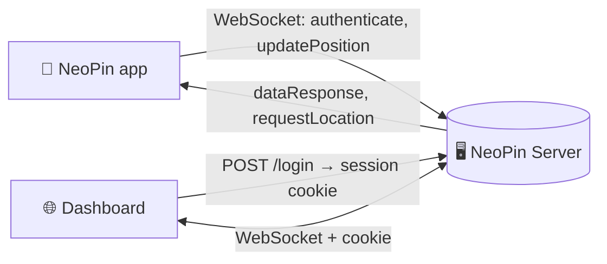
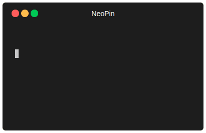

<div align="center">


# NeoPin Server

The backend for the [NeoPin app](https://github.com/vxnsin/NeoPin): phones connect, the server remembers where everyone is and shows it on a web dashboard.

[](https://nodejs.org)
[](https://github.com/inkanjs/inkan)
[](LICENSE)

<br>


</div>

## How it works

One Node process on one port. Phones and the dashboard both talk to it over a WebSocket, the dashboard login is a normal HTTP form.



A device logs in with the shared password and a name. Every position it sends is kept in memory and pushed to all other devices and dashboards, at most twice a second. When someone hits refresh, the server asks every device for a fresh position and waits up to two seconds for the answers.

There is no database. Restart the server and all devices and positions are gone.

It is built on [inkan](https://github.com/inkanjs/inkan) with [`@inkanjs/session`](https://github.com/inkanjs/middleware/tree/main/packages/session) for the dashboard login and [`@inkanjs/secure-headers`](https://github.com/inkanjs/middleware/tree/main/packages/secure-headers) for CSP and the other security headers. Every message on the socket is checked against a schema, and anything that doesn't fit closes the connection.

## Quick start

Node.js 22.18 or newer.

```bash
git clone -b Server https://github.com/vxnsin/NeoPin.git neopin-server
cd neopin-server
npm install
npm start
```

On first start a `.env` is written with `PORT=3012` and the password `neopin123`. Change it before anyone else can reach the server, in `.env` or with `changePassword neopin123 <new>` in the console.

Then open `http://<your-ip>:3012` in a browser, or enter `ws://<your-ip>:3012` in the app.

<div align="center">

</div>

### Docker

```bash
git clone -b Server https://github.com/vxnsin/NeoPin.git neopin-server
cd neopin-server
# set PASSWORD in docker-compose.yml
docker compose up -d --build
```

The console works with `docker attach <container>`, detach again with `Ctrl+P Ctrl+Q`. Without a TTY it is simply off.

## Running it on the internet

Plain `ws://` is fine inside your own network. Anywhere else the password and every position would go over the wire unencrypted, so put a reverse proxy with HTTPS in front (Caddy is the least work) and set:

| Variable | Set to | Why |
|---|---|---|
| `TRUST_PROXY` | `true` | Take the client IP and `https` from the proxy's `X-Forwarded-*` headers, so rate limits hit the right address |
| `SECURE_COOKIES` | `true` | The dashboard cookie is only sent over HTTPS |

The app then connects to `wss://your.domain`.

## Configuration

Values come from `.env` in the project root, real environment variables win.

| Variable | Default | Purpose |
|---|---|---|
| `PORT` | `3012` | HTTP and WebSocket port |
| `PASSWORD` | `neopin123` | Shared password for apps and the dashboard |
| `TRUST_PROXY` | `false` | See above |
| `SECURE_COOKIES` | `false` | See above |

Everything else (heartbeat 30 s, location wait 2 s, dashboard session 5 h, 5 logins per minute, 10 wrong device passwords per minute per IP) lives in `src/config.js`.

## Console

| Command | What it does |
|---|---|
| `help` | Lists the commands |
| `device-list` | Every known device with status, position and last ping |
| `sendPing [deviceId]` | Asks one device, or all of them, for a fresh position |
| `disconnect <deviceId>` | Kicks a device. The app won't reconnect on its own until it logs in again |
| `changePassword <current> <new>` | New password right away. Kicks all devices and logs out all dashboards |
| `sessions-clear` | Logs out every dashboard |

## WebSocket protocol

Connect to `/`. All messages are JSON, the first one has to be `authenticate`.

**Client → Server**

| Message | Answer |
|---|---|
| `{ "type": "authenticate", "deviceId", "password" }` | `{ "successful": true }` and a `dataResponse` |
| `{ "type": "authenticate", "viewer": true }` | The same for the dashboard. Needs the session cookie and the dashboard's own origin. |
| `{ "type": "updatePosition", "latitude", "longitude" }` | Stored and broadcast as `dataResponse` |
| `{ "type": "pingDevices" }` | `requestLocation` to every other device, then `dataResponse` |
| `{ "type": "getData" }` | `dataResponse` from memory |
| `{ "type": "ping" }` | `{ "type": "pong" }` |
| `{ "type": "locationError", "message"? }` | Logged on the console |

**Server → Client**

| Message | Meaning |
|---|---|
| `{ "type": "requestLocation", "from"? }` | Please send an `updatePosition` |
| `{ "type": "dataResponse", "devices": [...] }` | `{ deviceId, position, lastPing, status }` per device, after every change |

**Close codes**

| Code | Reason |
|---|---|
| `4000` | Wrong password, too many attempts, kicked from the console, or the password changed. Don't retry with the same login. |
| `4001` | The same device name connected again, the newer connection wins |
| `1007` | A message that isn't JSON or doesn't match the protocol |

The server pings every connection every 30 seconds and drops the ones that don't answer.

## HTTP

The dashboard session is an HttpOnly, SameSite=Strict cookie (`neopin_session`) issued by `POST /login`.

| Method | Path | Auth | |
|---|---|---|---|
| `GET` | `/` | session | Dashboard, otherwise redirects to `/login.html` |
| `POST` | `/login` | | `{ "password" }`. `401` when wrong, `429` after 5 tries a minute |
| `GET` | `/logout` | | Ends the session |
| `GET` | `/api/getData` | session | All devices |
| `POST` | `/api/sendPing` | session | `{ "deviceId"? }`, asks one or all devices for a position and answers with the list |
| `GET` | `/docs`, `/openapi.json` | | API docs and OpenAPI, generated by inkan |

## Project structure

```
server.js          # start, banner
src/
├─ app.js          # inkan app: routes, WebSocket protocol, broadcast
├─ config.js       # .env, timings, password check and change
├─ devices.js      # in-memory device registry
├─ sessions.js     # dashboard sessions (@inkanjs/session)
├─ rateLimit.js    # counter for wrong device passwords
└─ console.js      # interactive commands
public/            # login page, dashboard, styles and scripts
test/              # node:test
```

## Tests

```bash
npm test
```

Starts the server on a random port and runs through it with real sockets: device login, wrong passwords and lockout, broadcast, reconnect, location requests, dashboard login, sessions, rate limit and the viewer socket.

## License

[MIT](LICENSE)

---

<div align="center">
<sub>Part of <a href="https://github.com/vxnsin/NeoPin">NeoPin</a> · made by <a href="https://github.com/vxnsin">Vensin</a></sub>
</div>
