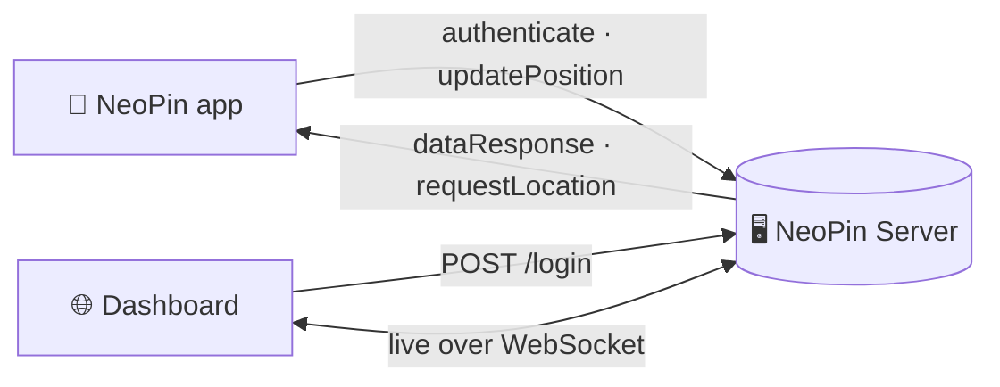

<div align="center">


# NeoPin Server

**Your phones, your server, one map.**<br>
The backend for the [NeoPin app](https://github.com/vxnsin/NeoPin).

[](https://nodejs.org)
[](https://github.com/inkanjs/inkan)
[](#docker)
[](LICENSE)

[**Quick start**](#quick-start) · [**Docker**](#docker) · [**On the internet**](#on-the-internet) · [**Protocol**](#websocket-protocol) · [**App**](https://github.com/vxnsin/NeoPin)

<br>


</div>

<br>

## How it works



Phones log in with a shared password and a name and send their position whenever they move. The server keeps the latest position of every device in memory and pushes each change to all phones and dashboards, at most twice a second. Hit refresh and it asks every device for a fresh fix.

No database, no third party, nothing written to disk. Profile pictures live in memory too. Restart it and the map is empty.

It runs on [inkan](https://github.com/inkanjs/inkan), with [`@inkanjs/session`](https://github.com/inkanjs/middleware/tree/main/packages/session) for the dashboard login and [`@inkanjs/secure-headers`](https://github.com/inkanjs/middleware/tree/main/packages/secure-headers) for the CSP. Every socket message is checked against a schema, and inkan serves the API docs at `/docs`.

## Quick start

> [!NOTE]
> Needs Node.js 22.18 or newer.

```bash
git clone -b Server https://github.com/vxnsin/NeoPin.git neopin-server
cd neopin-server
npm install
npm start
```

The first start writes a `.env` with `PORT=3012` and the password `neopin123`.

> [!IMPORTANT]
> Change the password before anyone else can reach the server: edit `.env`, or type `changePassword neopin123 <new>` in the running console.

Then open **`http://<your-ip>:3012`** in a browser, or enter **`ws://<your-ip>:3012`** in the app.

### Docker

```bash
git clone -b Server https://github.com/vxnsin/NeoPin.git neopin-server
cd neopin-server
# set PASSWORD in docker-compose.yml
docker compose up -d --build
```

`docker attach <container>` opens the console, `Ctrl+P` `Ctrl+Q` leaves it again.

## On the internet

Plain `ws://` is fine at home. On any other network the password and every position travel unencrypted, so put a reverse proxy with HTTPS in front. [Caddy](https://caddyserver.com) does it in two lines:

```caddyfile
neopin.example.com {
    reverse_proxy localhost:3012
}
```

Then set these two in `.env` and connect the app to `wss://neopin.example.com`:

| Variable | Value | What it does |
|:--|:--|:--|
| `TRUST_PROXY` | `true` | Reads the client IP and `https` from the proxy, so rate limits hit the right address |
| `SECURE_COOKIES` | `true` | The dashboard cookie only travels over HTTPS |

## Configuration

`.env` in the project root, real environment variables win.

| Variable | Default | |
|:--|:--|:--|
| `PORT` | `3012` | HTTP and WebSocket port |
| `PASSWORD` | `neopin123` | Shared password for apps and the dashboard |
| `TRUST_PROXY` | `false` | See [On the internet](#on-the-internet) |
| `SECURE_COOKIES` | `false` | See [On the internet](#on-the-internet) |

Timings and limits live in [`src/config.js`](src/config.js): heartbeat 30 s, location wait 2 s, dashboard session 5 h, 5 logins, 10 wrong device passwords and 120 profile picture requests per minute and IP.

## Console

Type into the running server:

| Command | |
|:--|:--|
| `device-list` | Every known device with status, position and last ping |
| `sendPing [deviceId]` | Ask one device, or all, for a fresh position |
| `disconnect <deviceId>` | Kick a device. It stays out until the app logs in again |
| `changePassword <current> <new>` | New password right away, kicks all devices and dashboards |
| `sessions-clear` | Log out every dashboard |
| `help` | All of the above |

## WebSocket protocol

Connect to `/` and send JSON. The first message has to be `authenticate`.

<details>
<summary><b>Client → Server</b></summary>
<br>

| Message | Answer |
|:--|:--|
| `{ "type": "authenticate", "deviceId", "password" }` | `{ "successful": true }`, then a `dataResponse` |
| `{ "type": "authenticate", "viewer": true }` | Same for the dashboard, needs its session cookie and origin |
| `{ "type": "updatePosition", "latitude", "longitude" }` | Stored and broadcast |
| `{ "type": "pingDevices" }` | `requestLocation` to every other device, then `dataResponse` |
| `{ "type": "getData" }` | `dataResponse` from memory |
| `{ "type": "ping" }` | `{ "type": "pong" }` |
| `{ "type": "locationError", "message"? }` | Logged on the console |

</details>

<details>
<summary><b>Server → Client</b></summary>
<br>

| Message | Meaning |
|:--|:--|
| `{ "type": "requestLocation", "from"? }` | Send an `updatePosition` now |
| `{ "type": "dataResponse", "devices": [...] }` | `{ deviceId, position, lastPing, status, avatarUrl }` per device, after every change |

</details>

<details>
<summary><b>Close codes</b></summary>
<br>

| Code | Why | What the app does |
|:--|:--|:--|
| `4000` | Wrong password, too many attempts, kicked, or the password changed | Stops and waits for a new login |
| `4001` | The same device name connected again | Nothing, the newer connection wins |
| `1007` | Not JSON, or not part of the protocol | Reconnects |

The server also pings every connection every 30 seconds and drops the ones that stay silent.

</details>

## HTTP

<details>
<summary><b>Routes</b></summary>
<br>

The dashboard session is an HttpOnly, SameSite=Strict cookie named `neopin_session`.

| | Path | Session | |
|:--|:--|:--:|:--|
| `GET` | `/` | ✓ | Dashboard, otherwise a redirect to `/login` |
| `GET` | `/login` | | Login page. `/login.html` still redirects here |
| `POST` | `/login` | | `{ "password" }`, `401` when wrong, `429` after 5 tries a minute |
| `GET` | `/logout` | | Ends the session |
| `GET` | `/api/getData` | ✓ | All devices |
| `POST` | `/api/sendPing` | ✓ | `{ "deviceId"? }`, asks one or all devices and answers with the list |
| `PUT` | `/api/avatar` | device | Sets the device's profile picture: JPEG, PNG or WebP, at most 16 KB |
| `DELETE` | `/api/avatar` | device | Removes it again |
| `GET` | `/avatars/:deviceId` | ✓ or device | The picture. Its URL changes with every new one, so it is cached for good |
| `GET` | `/docs` · `/openapi.json` | | API docs, generated by inkan |

Routes marked *device* are for the app: the device name in `X-Device-Id` and the server password as `Authorization: Bearer …`, both percent-encoded. Wrong passwords count against the same lockout as on the socket.

</details>

## Development

```bash
npm test
```

The tests start the server on a random port and go through it with real sockets: logins and lockout, broadcast, reconnect, location requests, dashboard sessions, rate limits.

```
server.js          start and banner
src/
├─ app.js          routes, WebSocket protocol, broadcast
├─ config.js       .env, timings, password check
├─ devices.js      in-memory device registry
├─ sessions.js     dashboard sessions
├─ rateLimit.js    counter for wrong device passwords
└─ console.js      interactive commands
public/            login page and dashboard
test/              node:test
```

<br>

<div align="center">
<sub><a href="LICENSE">MIT</a> · part of <a href="https://github.com/vxnsin/NeoPin">NeoPin</a> · made by <a href="https://github.com/vxnsin">Vensin</a></sub>
</div>
