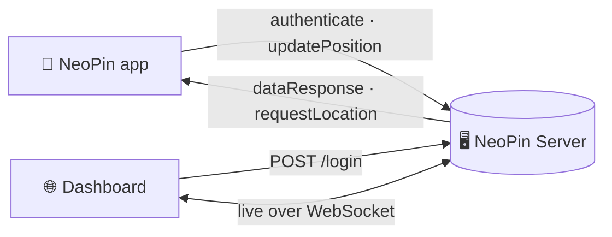

<div align="center">


# NeoPin Server

**Your phones, your server, one map.**<br>
The backend for the [NeoPin app](https://github.com/vxnsin/NeoPin).

[](https://nodejs.org)
[](https://github.com/inkanjs/inkan)
[](#docker)
[](LICENSE)

[**Quick start**](#quick-start) · [**Docker**](#docker) · [**On the internet**](#on-the-internet) · [**Protocol**](#websocket-protocol) · [**App**](https://github.com/vxnsin/NeoPin)

<br>


</div>

<br>

## How it works



Everyone has an account: a username and a password, created by the admin in the dashboard or by signing up with an [invite code](#invite-codes). A phone logs in with it once, gets a token and sends its position whenever it moves. The server keeps the latest position of every device in memory and pushes each change to all phones and dashboards, at most twice a second. Hit refresh and it asks every device for a fresh fix.

Accounts, profile pictures and the location history live in a SQLite file (`data/neopin.db`, built in `node:sqlite`, no extra database to run). The timeline in the dashboard shows the stays and trips of a device per day, built from that history. Positions older than `HISTORY_DAYS` are deleted at startup. The live map itself is memory only, so after a restart it fills up again as devices reconnect.

It runs on [inkan](https://github.com/inkanjs/inkan), with [`@inkanjs/session`](https://github.com/inkanjs/middleware/tree/main/packages/session) for the dashboard login and [`@inkanjs/secure-headers`](https://github.com/inkanjs/middleware/tree/main/packages/secure-headers) for the CSP. Every socket message is checked against a schema, and inkan serves the API docs at `/docs`.

## Quick start

> [!NOTE]
> Needs Node.js 22.18 or newer.

```bash
git clone -b Server https://github.com/vxnsin/NeoPin.git neopin-server
cd neopin-server
npm install
npm start
```

The first start writes a `.env` with `PORT=3012`, creates the database and the admin account `admin` with a generated password. It is printed once in the console, right under the banner.

> [!IMPORTANT]
> Copy that password now, it is not shown again. The dashboard asks you to change it after the first login. Set `ADMIN_PASSWORD` in `.env` before the first start if you want to choose it yourself.

Then open **`http://<your-ip>:3012`**, log in as the admin and create an account for everyone who should use the app. In the app enter **`ws://<your-ip>:3012`** and log in with that account.

### Docker

Every push to the `Server` branch builds an image for `amd64` and `arm64` and publishes it on the GitHub Container Registry: `ghcr.io/vxnsin/neopin-server`. Tags: `latest` (the `Server` branch), `sha-<commit>` and, for releases, `1.2.3` / `1.2`.

```bash
docker run -d --name neopin -p 3012:3012 -v neopin-data:/app/data --restart unless-stopped \
  ghcr.io/vxnsin/neopin-server:latest
docker logs neopin
```

The admin account is created on the first start, and `docker logs neopin` shows its generated password once. No console or TTY is needed. To choose your own, add `-e ADMIN_USERNAME=admin -e ADMIN_PASSWORD=<password>`. Everything that matters (database, accounts, history) lives in the volume at `/app/data`, so back that up.

With Compose, [`docker-compose.yml`](docker-compose.yml) does the same and keeps a `build: .` line in a comment if you want to build the image from a checkout instead:

```bash
docker compose up -d
docker compose logs neopin
```

**Updates.** `docker compose pull && docker compose up -d` fetches the newest image and recreates the container, the volume stays. To do that automatically, uncomment the `watchtower` service in the compose file: it checks every 5 minutes and only touches containers with the `com.centurylinklabs.watchtower.enable` label, which `neopin` has.

> [!NOTE]
> A package that GitHub created is private at first. Open the package settings of `neopin-server` on GitHub once and set its visibility to public, otherwise servers need `docker login ghcr.io` to pull it.

`docker attach neopin` opens the console when the container was started with `-it` (`stdin_open` and `tty` in Compose), `Ctrl+P` `Ctrl+Q` leaves it again.

## On the internet

Plain `ws://` is fine at home. On any other network passwords, tokens and every position travel unencrypted, so put a reverse proxy with HTTPS in front. [Caddy](https://caddyserver.com) does it in two lines:

```caddyfile
neopin.example.com {
    reverse_proxy localhost:3012
}
```

Then set these two in `.env` and connect the app to `wss://neopin.example.com`:

| Variable | Value | What it does |
|:--|:--|:--|
| `TRUST_PROXY` | `true` | Reads the client IP and `https` from the proxy, so rate limits hit the right address |
| `SECURE_COOKIES` | `true` | The dashboard cookie only travels over HTTPS |

## Configuration

`.env` in the project root, real environment variables win.

| Variable | Default | |
|:--|:--|:--|
| `PORT` | `3012` | HTTP and WebSocket port |
| `DATABASE_PATH` | `data/neopin.db` | SQLite file, relative to the project root. In Docker `/app/data` is the volume |
| `ADMIN_USERNAME` | `admin` | Name of the admin account, only read while it is created on the first start |
| `ADMIN_PASSWORD` | generated | Password of that account. Without it one is generated and printed once |
| `HISTORY_DAYS` | `365` | Location history older than this is deleted at startup |
| `PLACE_LOOKUP_URL` | `https://overpass-api.de/api/interpreter` | Overpass API that names the places in the timeline. It sees the coordinates of the stays it is asked about, each spot once, the answers are cached. Point it at your own Overpass or set `off` |
| `PLACE_FALLBACK_URL` | `https://photon.komoot.io/reverse` | Photon, asked when Overpass is busy or down. Same privacy as above, `off` turns it off |
| `TRANSIT` | on | Timetable data for bus, tram and train lines in the timeline, see [Transit data](#transit-data). `off` turns it off |
| `TRANSIT_CATALOG_URL` | the [Mobility Database](https://mobilitydatabase.org) catalog CSV | Which GTFS feeds exist and what each covers |
| `TRANSIT_DIR` | `data/transit` | Where the catalog and the downloaded feeds are kept, next to the database |
| `TRANSIT_REGION_KM` | `30` | Size of the regions that get timetable data, around wherever the accounts have been |
| `ROAD_MATCH_URL` | `https://routing.openstreetmap.de/routed-{profile}` | OSRM server that snaps trips to the roads, see [Smoother paths](#smoother-paths). `{profile}` becomes `car`, `bike` or `foot`. It sees the whole way of every trip it is asked about. Point it at your own OSRM or set `off` |
| `FCM_SERVICE_ACCOUNT_FILE` | off | Path to the Firebase service account key, see [Push notifications](#push-notifications). `off` or unset turns push off |
| `FCM_SERVICE_ACCOUNT_JSON` | off | The same key as inline JSON, for setups without a file. The inline JSON wins when both are set |
| `PUSH_WAIT_MS` | `20000` | How long asking an offline phone for its location waits for the answer |
| `INVITE_CODES` | on | Sign-up with invite codes, see [Invite codes](#invite-codes). `off` turns it off |
| `INVITE_TTL_DAYS` | `7` | How long an invite code stays valid |
| `INVITE_MAX_OPEN` | `5` | Open codes a non-admin account may hold at once, the admin has no limit |
| `TRUST_PROXY` | `false` | See [On the internet](#on-the-internet) |
| `SECURE_COOKIES` | `false` | See [On the internet](#on-the-internet) |

Timings and limits live in [`src/config.js`](src/config.js): heartbeat 30 s, location wait 2 s, dashboard session 5 h, 5 logins, 10 wrong device tokens and 120 profile picture requests per minute and IP.

## Invite codes

Without an invite there is no sign-up: the admin creates accounts. With invite codes anybody who is signed in can bring a friend along.

- `POST /api/invite-codes` makes a code, optionally for one of your groups (`groupId`, the admin may pick any) with a `note` of up to 60 characters. It looks like `7K3QM-X9TV2`: 10 characters of Crockford base32 (no `I`, `L`, `O`, `U`). Typing it is forgiving: case, spaces and dashes do not matter, `O` is read as `0`, `I` and `L` as `1`.
- A code works once and for `INVITE_TTL_DAYS` days. A non-admin holds at most `INVITE_MAX_OPEN` open codes (`429` beyond that), revoking, using or expiring one frees a slot. `GET /api/invite-codes` lists your codes with their status (`open`, `used`, `expired`, `revoked`), the admin sees all. `DELETE /api/invite-codes/:id` revokes an open one.
- The sign-up page can ask `POST /api/invite-codes/check` (`{ "code" }`) who invited and to which group. It only says `valid: true` or `false`, never why.
- `POST /api/register` (`{ "code", "username", "password", "displayName"? }`) creates the account in one step with the code: a normal, non-admin account that does not have to change its password. It joins the fixed groups like every new account, and the code's group on top of that, without a pending invite. Afterwards the client logs in as usual. Unknown, used, expired and revoked codes all answer the same `404`. A taken or invalid username answers `409` / `400` and the code stays unused.
- A code is shared as `https://your-server/invite/7K3QM-X9TV2`, a link every messenger makes clickable. The page says who invited, opens the app with the code and this server's address (`neopin://invite?code=…&server=…`; on Android with a fallback to the browser when the app is missing) and offers the sign-up in the browser (`/login?code=…`).
- Wrong codes count against the same per-IP limit as wrong device tokens, and both routes share the login limit.
- When a code is used, the admin accounts and the creator get a notification (`GET /api/notifications`, `POST /api/notifications/read`), a `{ "type": "notificationsChanged" }` message on their sockets and, where [push](#push-notifications) is set up, a push `New account`.

`INVITE_CODES=off` answers `404 invites-off` on create, check and register, and `GET /api/status` has `"invites": false`.

## Push notifications

With a Firebase project the server can wake a phone that has no connection and ask it for a fresh location, and it can notify people about group invitations and find requests. Without credentials push is off, nothing else changes, and `GET /api/status` says `"push": false` so the clients hide the feature.

How it works: the app registers its FCM token with `PUT /api/push-token` (`{ "token", "platform": "android" | "ios" }`, device auth, `DELETE` removes it). When someone asks for the location of a device that has no open socket (`POST /api/sendPing` with its `deviceId` and `userId`), is allowed to see it, and the device has a token, the server sends a high-priority data message and waits up to `PUSH_WAIT_MS` for the phone to report. It answers `200` with the refreshed list, or `202` when the phone has not answered yet. At most one wake-up per device every 10 seconds.

Find over push: when somebody asks to find a person (`findRequest`) and that person has devices with a token but none online, the request is not ended with `offline`. It stays pending for the usual two minutes, the asker gets `findPending`, and every device of the person without an open socket gets a notification push (title `Find request`, body `<name> wants to find you`, high priority, channel `default`) with the data `{ "type": "findRequest", "session": "<id>", "from": "<display name>" }` (all values strings). Devices that are online only get the WebSocket message. A device that connects while the request is pending receives the `findRequest` message right after its first `dataResponse`, so tapping the notification, opening the app and connecting shows the question; answering works as usual with `findAnswer`. At most one find push per asker and asked person every 30 seconds. Hidden people and people outside the asker's groups are treated as before, the asker cannot tell whether a push went out. Without FCM or without a token the request still ends with `offline`.

Tokens that FCM reports as dead are deleted, as are the tokens of unlinked devices.

Set it up:

1. Open [console.firebase.google.com](https://console.firebase.google.com), **Add project**.
2. In the project add an **Android app** with the package name `de.vensin.neopin` and download `google-services.json`. It goes into the app build.
3. **Project settings → Service accounts → Generate new private key**. This JSON is the server's credential, keep it secret.
4. Give it to the server and restart:

```yaml
services:
  neopin:
    environment:
      - FCM_SERVICE_ACCOUNT_FILE=/app/data/firebase-service-account.json
    volumes:
      - neopin-data:/app/data   # put the key file into this volume
```

Or bind-mount it read-only: `./firebase-service-account.json:/run/secrets/fcm.json:ro` with `FCM_SERVICE_ACCOUNT_FILE=/run/secrets/fcm.json`.

Limits:

- An Android app that was force-stopped receives no push until it is opened again, and aggressive battery managers of some manufacturers (Xiaomi, Huawei, Oppo, Samsung sleeping apps, ...) hold or drop pushes of apps they put to sleep.
- iOS needs APNs: an Apple Developer account and an APNs key uploaded to the Firebase project. iOS also throttles silent pushes and does not run them for apps the user swiped away, so waking an iPhone is best effort.
- One app build is tied to one Firebase project (its `google-services.json`). A server can only push to apps built for the project of its service account.

## Transit data

Rides by bus, tram or train need timetables, and nobody keeps the timetables of the whole world. The server holds only the [Mobility Database](https://mobilitydatabase.org) catalog, a CSV with every known [GTFS](https://gtfs.org) feed, its provider, license and the rectangle on the map it covers. From the stored positions of all accounts it knows its **regions**: cells of about `TRANSIT_REGION_KM` that had positions in the last 90 days. For every region it downloads the feeds that cover it and imports only the slice inside the region (stops, lines, trips, departures, shapes) into SQLite. That happens in the background, shortly after the start and then once a week; the start never waits for it. A region nobody has been in for 90 days loses its data again. `GET /api/transit` shows the regions, their feeds and when they were last imported.

Germany is covered by the nationwide feed from [gtfs.de](https://gtfs.de) (data by DELFI e.V., includes DB Regio and long-distance trains) instead of the catalog's pieces, because it covers everything. It is about 300 MB, so the first import takes a few minutes. The server sends its name and version as user agent to the catalog and the feed hosts, nothing about the accounts.

A short wait at a stop leaves no visit, so the walk to the stop, the ride and the walk from it arrive as one trip. The server cuts such a trip where the phone speeds up next to a stop and where it slows down next to one, and the timeline shows the walks and the ride separately. With the data in place, a trip in the timeline that starts and ends at a stop (a station counts up to 200 m away, its platforms are long) is matched against the lines serving both stops in that order. A bus or tram ride has to halt every few hundred metres; a train, subway or ferry calls every few kilometres or not at all, so instead its departure and its arrival both have to be within ten minutes of the timetable and a train has to have averaged 25 km/h. The line's shape has to follow the fixes, and of several lines the one with a departure closest to the observed one wins. Such a trip comes back with `mode: "transit"` and a `transit` object (kind, line, headsign, colours, agency, the stops boarded and left, `source: "gtfs"`). Where no timetable covers a ride with bus-like halts but OpenStreetMap has route relations at both stops (asked through `PLACE_LOOKUP_URL`, cached like the place names), at least the line number comes back with `source: "osm"`. Results are stored per account, device and trip, and a correction sent with `PUT /api/trips/mode` wins over all of it. The battery profile of the app sends too few fixes for any of this.

**Licenses.** The catalog is published by MobilityData under [Apache 2.0](https://github.com/MobilityData/mobility-database-catalogs/blob/main/LICENSE). Every feed comes under its own license, listed in the catalog and shown in `GET /api/transit`. Many feeds, the gtfs.de one included, are **CC BY 4.0**: if you show the lines to others (a public dashboard, screenshots), name the source, e.g. "Timetable data: gtfs.de / DELFI e.V., CC BY 4.0". Some feeds in the catalog need a login or an API key; those are skipped.

## Smoother paths

With the Balanced profile the app reports every 15 s, with Battery every 2 minutes, and straight lines between those fixes cut through every corner. So the timeline draws trips along the way they really went:

- A recognised bus, tram or train ride follows the line's own course from its timetable, from the boarding to the alighting stop.
- Walks, bike rides, drives and buses without a known course are snapped to the roads by an [OSRM](https://project-osrm.org) match service with the foot, bike or car profile. Trams, trains and ferries without a course keep their fixes.

The server replaces the trip's `path` with that course and says where it came from in `pathSource` (`line` or `road`); without it the path is the fixes themselves. Distances still come from the fixes. A match that is much longer than the fixes is a detour the phone never made and is not used. Results are cached per trip; a day that is still being matched says `pathsPending`, and a reload a few seconds later has the rest.

**Privacy.** Unlike the place lookup, which only sees single spots, the routing service sees the whole way of every trip it matches. The default is the public OSRM of [FOSSGIS](https://routing.openstreetmap.de), which logs requests (see its privacy statement). It gets the coordinates and the seconds between the fixes, not the date or the account, and not the centres of the stays at both ends of a trip. Run your own [OSRM](https://github.com/Project-OSRM/osrm-backend) and point `ROAD_MATCH_URL` at it, or set it to `off` and the fixes are drawn as they are. FOSSGIS allows light use only: one request a second (the server keeps to it), a valid user agent, and attribution: the routes are based on [OpenStreetMap](https://www.openstreetmap.org/copyright) data, © OpenStreetMap contributors.

## Console

Type into the running server. It only starts when a terminal is attached; without one (Docker without `-it`) it stays off and the dashboard does the same jobs.

| Command | |
|:--|:--|
| `users` | Every account |
| `createUser <name> <password>` | New account |
| `passwd <name> <password>` | New password for an account, kicks its devices and all dashboards |
| `device-list` | Every known device with status, position and last ping |
| `sendPing <name> [deviceId]` | Ask one or all devices of an account for a fresh position |
| `disconnect <name> <deviceId>` | Kick a device. It stays out until the app logs in again |
| `sessions-clear` | Log out every dashboard |
| `help` | All of the above |

## WebSocket protocol

Connect to `/` and send JSON. The first message has to be `authenticate`. The app gets its token from `POST /api/auth/login` first.

<details>
<summary><b>Client → Server</b></summary>
<br>

| Message | Answer |
|:--|:--|
| `{ "type": "authenticate", "deviceId", "token", "deviceType"? }` | `{ "successful": true }`, then a `dataResponse` |
| `{ "type": "authenticate", "viewer": true }` | Same for the dashboard, needs its session cookie and origin |
| `{ "type": "updatePosition", "latitude", "longitude", "battery"? }` | Stored and broadcast. `battery` is `{ "level": 0–100, "charging" }` |
| `{ "type": "updateBattery", "level", "charging" }` | Only the battery changed, stored and broadcast |
| `{ "type": "pingDevices" }` | `requestLocation` to every other device, then `dataResponse` |
| `{ "type": "getData" }` | `dataResponse` from memory |
| `{ "type": "findRequest", "userId" }` | Ask to find that person. `findRequest` to their devices (a push to those without a connection, see [Push notifications](#push-notifications)) and `findPending` back, or `findEnded` with a reason |
| `{ "type": "findAnswer", "session", "accept" }` | The asked person says yes or no. Yes: `findStarted` to both sides |
| `{ "type": "findPosition", "session", "latitude", "longitude", "accuracy"?, "heading"? }` | Forwarded to the other side as `findPosition`, not stored |
| `{ "type": "findEnd", "session" }` | Ends the find, both sides get `findEnded` |
| `{ "type": "ping" }` | `{ "type": "pong" }` |
| `{ "type": "locationError", "message"? }` | Logged on the console |

</details>

<details>
<summary><b>Server → Client</b></summary>
<br>

| Message | Meaning |
|:--|:--|
| `{ "type": "requestLocation", "from"? }` | Send an `updatePosition` now |
| `{ "type": "findRequest", "session", "from", "expiresAt" }` | Somebody wants to find you, answer within two minutes. Also sent right after the `dataResponse` to a device that connects while the request is pending |
| `{ "type": "findPending" | "findStarted", "session", "peer", "expiresAt" }` | Your request is waiting, or both sides share positions now, for up to half an hour |
| `{ "type": "findPosition", "session", "latitude", "longitude", "accuracy", "heading", "at" }` | Where the other side is right now |
| `{ "type": "findEnded", "session", "reason" }` | `declined`, `timeout`, `answered` (on another device), `disconnected`, `offline`, `unavailable`, `replaced` or `ended` |
| `{ "type": "dataResponse", "devices": [...] }` | `{ deviceId, userId, owner, position, lastPing, status, battery, ... }` per device, after every change. `battery` is `null` until the device reported one, and stays the last reading (with its `updatedAt`) while the device is offline |

</details>

<details>
<summary><b>Close codes</b></summary>
<br>

| Code | Why | What the app does |
|:--|:--|:--|
| `4000` | Wrong token, too many attempts, kicked, or the password changed | Stops and waits for a new login |
| `4001` | The same device name connected again | Nothing, the newer connection wins |
| `1007` | Not JSON, or not part of the protocol | Reconnects |

The server also pings every connection every 30 seconds and drops the ones that stay silent.

</details>

## HTTP

<details>
<summary><b>Routes</b></summary>
<br>

The dashboard session is an HttpOnly, SameSite=Strict cookie named `neopin_session`. The full list with schemas is at `/docs`.

| | Path | Auth | |
|:--|:--|:--:|:--|
| `GET` | `/` | session | Dashboard, otherwise a redirect to `/login` |
| `GET` | `/login` | | Login page |
| `POST` | `/login` | | `{ "username", "password" }`, sets the cookie. `401` when wrong, `429` after 5 tries a minute |
| `POST` | `/api/auth/login` | | `{ "username", "password", "deviceId", "deviceType"? }`, answers with the device `token` |
| `GET` | `/logout` | | Ends the session |
| `GET` | `/api/status` | | `{ "version", "commit", "builtAt", "push", "invites" }`, used by the login screens and the Docker health check |
| `POST` | `/api/register` | | `{ "code", "username", "password", "displayName"? }` signs up with an [invite code](#invite-codes), `201` with the account. `404` for any invalid code, `409` username taken |
| `POST` | `/api/invite-codes/check` | | `{ "code" }` answers `{ "valid", "invitedBy"?, "groupName"? }` |
| `POST` `GET` | `/api/invite-codes` | ✓ | Create a code (`{ "groupId"?, "note"? }`, `201`) and list your own, the admin gets all |
| `DELETE` | `/api/invite-codes/:id` | ✓ | Revokes an open code. `204`, else `404` |
| `GET` | `/api/notifications` | ✓ | Your latest 50 notifications, newest first (`inviteUsed`) |
| `POST` | `/api/notifications/read` | ✓ | `{ "ids"? }` marks them read, all when omitted. `204` |
| `GET` | `/api/me` | ✓ | The signed-in account |
| `POST` | `/api/me/password` | ✓ | `{ "currentPassword", "newPassword" }`, at least 8 characters |
| `GET` | `/api/devices` | ✓ | The devices linked to the account |
| `PUT` | `/api/me/primary-device` | ✓ | `{ "deviceId" }` picks the device that stands for you, `null` goes back to automatic |
| `PUT` | `/api/users/:id/primary-device` | admin | The same for another account |
| `GET` | `/api/getData` | ✓ | All devices |
| `POST` | `/api/sendPing` | ✓ | `{ "deviceId"?, "userId"? }`, asks one or all devices and answers with the list. An offline device is woken with a push when [push](#push-notifications) is set up: `202` when it has not answered in time |
| `PUT` `DELETE` | `/api/push-token` | device | `{ "token", "platform" }` registers the FCM token of this device, `DELETE` forgets it. `204` |
| `GET` | `/api/timeline` · `/api/timeline/days` | ✓ | Stays and trips of a device per day, and the days that have data. Trip paths follow roads and lines where known, see [Smoother paths](#smoother-paths). The admin may pass `userId` |
| `GET` | `/api/transit` | ✓ | `{ enabled, regions: [{ cell, feeds, updatedAt }] }`: which regions have timetable data, see [Transit data](#transit-data) |
| `PUT` | `/api/trips/mode` | ✓ | `{ deviceId, start, mode }` corrects how a trip was made: `walking`, `cycling`, `driving`, `transit`, or `auto` to forget the correction. `404` when no trip of the device starts at `start` |
| `PUT` | `/api/visits/dismissed` | ✓ | `{ deviceId, start, end, dismissed }` removes a stop that was none, a red light or a jam: its fixes count as on the way and the trips around it become one. `dismissed: false` brings it back. The timeline lists the day's dismissed stops in `dismissed` |
| `GET` `POST` `PATCH` `DELETE` | `/api/users` | admin | List, create, edit and remove accounts |
| `PUT` | `/api/avatar` | ✓ | Sets the account's profile picture: JPEG, PNG or WebP, at most 16 KB |
| `DELETE` | `/api/avatar` | ✓ | Removes it again |
| `GET` | `/avatars/:userId` | ✓ | The picture. Its URL changes with every new one, so it is cached for good |
| `GET` | `/docs` · `/openapi.json` | | API docs, generated by inkan |

✓ means a dashboard session cookie, or from the app the device name in `X-Device-Id` and the token as `Authorization: Bearer ...`, both percent-encoded. Wrong tokens count against the same lockout as on the socket.

</details>

## Development

```bash
npm test
```

The tests start the server on a random port and go through it with real sockets: logins and lockout, accounts, avatars, timeline, broadcast, reconnect, location requests, dashboard sessions, rate limits.

```
server.js          start and banner
src/
├─ app.js          routes, WebSocket protocol, broadcast
├─ config.js       .env, timings
├─ db.js           SQLite schema
├─ accounts.js     users, tokens, admin bootstrap
├─ invites.js      invite codes and sign-up
├─ notifications.js stored notifications
├─ history.js      stored positions
├─ timeline.js     stays and trips per day
├─ transit.js      regions, the feed catalog, downloads and imports
├─ gtfs.js         reads GTFS tables out of a feed ZIP
├─ transitMatch.js which line a trip was, corrections
├─ overpass.js     one queue for every Overpass query
├─ paths.js        trips along the line's course or snapped to the roads
├─ devices.js      in-memory device registry
├─ sessions.js     dashboard sessions
├─ rateLimit.js    counter for wrong device tokens
└─ console.js      interactive commands
public/            login page and dashboard
test/              node:test
```

<br>

<div align="center">
<sub><a href="LICENSE">MIT</a> · part of <a href="https://github.com/vxnsin/NeoPin">NeoPin</a> · made by <a href="https://github.com/vxnsin">Vensin</a></sub>
</div>
