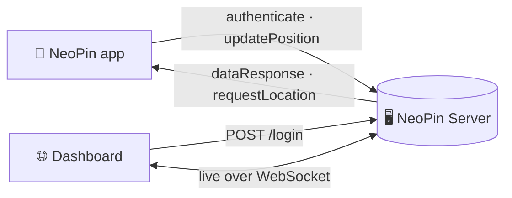

<div align="center">


# NeoPin Server

**Your phones, your server, one map.**<br>
The backend for the [NeoPin app](https://github.com/vxnsin/NeoPin).

[](https://nodejs.org)
[](https://github.com/inkanjs/inkan)
[](#docker)
[](LICENSE)

[**Quick start**](#quick-start) · [**Docker**](#docker) · [**On the internet**](#on-the-internet) · [**Protocol**](#websocket-protocol) · [**App**](https://github.com/vxnsin/NeoPin)

<br>


</div>

<br>

## How it works



Everyone has an account: a username and a password, created by the admin in the dashboard. A phone logs in with it once, gets a token and sends its position whenever it moves. The server keeps the latest position of every device in memory and pushes each change to all phones and dashboards, at most twice a second. Hit refresh and it asks every device for a fresh fix.

Accounts, profile pictures and the location history live in a SQLite file (`data/neopin.db`, built in `node:sqlite`, no extra database to run). The timeline in the dashboard shows the stays and trips of a device per day, built from that history. Positions older than `HISTORY_DAYS` are deleted at startup. The live map itself is memory only, so after a restart it fills up again as devices reconnect.

It runs on [inkan](https://github.com/inkanjs/inkan), with [`@inkanjs/session`](https://github.com/inkanjs/middleware/tree/main/packages/session) for the dashboard login and [`@inkanjs/secure-headers`](https://github.com/inkanjs/middleware/tree/main/packages/secure-headers) for the CSP. Every socket message is checked against a schema, and inkan serves the API docs at `/docs`.

## Quick start

> [!NOTE]
> Needs Node.js 22.18 or newer.

```bash
git clone -b Server https://github.com/vxnsin/NeoPin.git neopin-server
cd neopin-server
npm install
npm start
```

The first start writes a `.env` with `PORT=3012`, creates the database and the admin account `admin` with a generated password. It is printed once in the console, right under the banner.

> [!IMPORTANT]
> Copy that password now, it is not shown again. The dashboard asks you to change it after the first login. Set `ADMIN_PASSWORD` in `.env` before the first start if you want to choose it yourself.

Then open **`http://<your-ip>:3012`**, log in as the admin and create an account for everyone who should use the app. In the app enter **`ws://<your-ip>:3012`** and log in with that account.

### Docker

Every push to the `Server` branch builds an image for `amd64` and `arm64` and publishes it on the GitHub Container Registry: `ghcr.io/vxnsin/neopin-server`. Tags: `latest` (the `Server` branch), `sha-<commit>` and, for releases, `1.2.3` / `1.2`.

```bash
docker run -d --name neopin -p 3012:3012 -v neopin-data:/app/data --restart unless-stopped \
  ghcr.io/vxnsin/neopin-server:latest
docker logs neopin
```

The admin account is created on the first start, and `docker logs neopin` shows its generated password once. No console or TTY is needed. To choose your own, add `-e ADMIN_USERNAME=admin -e ADMIN_PASSWORD=<password>`. Everything that matters (database, accounts, history) lives in the volume at `/app/data`, so back that up.

With Compose, [`docker-compose.yml`](docker-compose.yml) does the same and keeps a `build: .` line in a comment if you want to build the image from a checkout instead:

```bash
docker compose up -d
docker compose logs neopin
```

**Updates.** `docker compose pull && docker compose up -d` fetches the newest image and recreates the container, the volume stays. To do that automatically, uncomment the `watchtower` service in the compose file: it checks every 5 minutes and only touches containers with the `com.centurylinklabs.watchtower.enable` label, which `neopin` has.

> [!NOTE]
> A package that GitHub created is private at first. Open the package settings of `neopin-server` on GitHub once and set its visibility to public, otherwise servers need `docker login ghcr.io` to pull it.

`docker attach neopin` opens the console when the container was started with `-it` (`stdin_open` and `tty` in Compose), `Ctrl+P` `Ctrl+Q` leaves it again.

## On the internet

Plain `ws://` is fine at home. On any other network passwords, tokens and every position travel unencrypted, so put a reverse proxy with HTTPS in front. [Caddy](https://caddyserver.com) does it in two lines:

```caddyfile
neopin.example.com {
    reverse_proxy localhost:3012
}
```

Then set these two in `.env` and connect the app to `wss://neopin.example.com`:

| Variable | Value | What it does |
|:--|:--|:--|
| `TRUST_PROXY` | `true` | Reads the client IP and `https` from the proxy, so rate limits hit the right address |
| `SECURE_COOKIES` | `true` | The dashboard cookie only travels over HTTPS |

## Configuration

`.env` in the project root, real environment variables win.

| Variable | Default | |
|:--|:--|:--|
| `PORT` | `3012` | HTTP and WebSocket port |
| `DATABASE_PATH` | `data/neopin.db` | SQLite file, relative to the project root. In Docker `/app/data` is the volume |
| `ADMIN_USERNAME` | `admin` | Name of the admin account, only read while it is created on the first start |
| `ADMIN_PASSWORD` | generated | Password of that account. Without it one is generated and printed once |
| `HISTORY_DAYS` | `365` | Location history older than this is deleted at startup |
| `PLACE_LOOKUP_URL` | `https://overpass-api.de/api/interpreter` | Overpass API that names the places in the timeline. It sees the coordinates of the stays it is asked about, each spot once, the answers are cached. Point it at your own Overpass or set `off` |
| `PLACE_FALLBACK_URL` | `https://photon.komoot.io/reverse` | Photon, asked when Overpass is busy or down. Same privacy as above, `off` turns it off |
| `TRUST_PROXY` | `false` | See [On the internet](#on-the-internet) |
| `SECURE_COOKIES` | `false` | See [On the internet](#on-the-internet) |

Timings and limits live in [`src/config.js`](src/config.js): heartbeat 30 s, location wait 2 s, dashboard session 5 h, 5 logins, 10 wrong device tokens and 120 profile picture requests per minute and IP.

## Console

Type into the running server. It only starts when a terminal is attached; without one (Docker without `-it`) it stays off and the dashboard does the same jobs.

| Command | |
|:--|:--|
| `users` | Every account |
| `createUser <name> <password>` | New account |
| `passwd <name> <password>` | New password for an account, kicks its devices and all dashboards |
| `device-list` | Every known device with status, position and last ping |
| `sendPing <name> [deviceId]` | Ask one or all devices of an account for a fresh position |
| `disconnect <name> <deviceId>` | Kick a device. It stays out until the app logs in again |
| `sessions-clear` | Log out every dashboard |
| `help` | All of the above |

## WebSocket protocol

Connect to `/` and send JSON. The first message has to be `authenticate`. The app gets its token from `POST /api/auth/login` first.

<details>
<summary><b>Client → Server</b></summary>
<br>

| Message | Answer |
|:--|:--|
| `{ "type": "authenticate", "deviceId", "token", "deviceType"? }` | `{ "successful": true }`, then a `dataResponse` |
| `{ "type": "authenticate", "viewer": true }` | Same for the dashboard, needs its session cookie and origin |
| `{ "type": "updatePosition", "latitude", "longitude", "battery"? }` | Stored and broadcast. `battery` is `{ "level": 0–100, "charging" }` |
| `{ "type": "updateBattery", "level", "charging" }` | Only the battery changed, stored and broadcast |
| `{ "type": "pingDevices" }` | `requestLocation` to every other device, then `dataResponse` |
| `{ "type": "getData" }` | `dataResponse` from memory |
| `{ "type": "findRequest", "userId" }` | Ask to find that person. `findRequest` to their devices and `findPending` back, or `findEnded` with a reason |
| `{ "type": "findAnswer", "session", "accept" }` | The asked person says yes or no. Yes: `findStarted` to both sides |
| `{ "type": "findPosition", "session", "latitude", "longitude", "accuracy"?, "heading"? }` | Forwarded to the other side as `findPosition`, not stored |
| `{ "type": "findEnd", "session" }` | Ends the find, both sides get `findEnded` |
| `{ "type": "ping" }` | `{ "type": "pong" }` |
| `{ "type": "locationError", "message"? }` | Logged on the console |

</details>

<details>
<summary><b>Server → Client</b></summary>
<br>

| Message | Meaning |
|:--|:--|
| `{ "type": "requestLocation", "from"? }` | Send an `updatePosition` now |
| `{ "type": "findRequest", "session", "from", "expiresAt" }` | Somebody wants to find you, answer within two minutes |
| `{ "type": "findPending" | "findStarted", "session", "peer", "expiresAt" }` | Your request is waiting, or both sides share positions now, for up to half an hour |
| `{ "type": "findPosition", "session", "latitude", "longitude", "accuracy", "heading", "at" }` | Where the other side is right now |
| `{ "type": "findEnded", "session", "reason" }` | `declined`, `timeout`, `answered` (on another device), `disconnected`, `offline`, `unavailable`, `replaced` or `ended` |
| `{ "type": "dataResponse", "devices": [...] }` | `{ deviceId, userId, owner, position, lastPing, status, battery, ... }` per device, after every change. `battery` is `null` until the device reported one |

</details>

<details>
<summary><b>Close codes</b></summary>
<br>

| Code | Why | What the app does |
|:--|:--|:--|
| `4000` | Wrong token, too many attempts, kicked, or the password changed | Stops and waits for a new login |
| `4001` | The same device name connected again | Nothing, the newer connection wins |
| `1007` | Not JSON, or not part of the protocol | Reconnects |

The server also pings every connection every 30 seconds and drops the ones that stay silent.

</details>

## HTTP

<details>
<summary><b>Routes</b></summary>
<br>

The dashboard session is an HttpOnly, SameSite=Strict cookie named `neopin_session`. The full list with schemas is at `/docs`.

| | Path | Auth | |
|:--|:--|:--:|:--|
| `GET` | `/` | session | Dashboard, otherwise a redirect to `/login` |
| `GET` | `/login` | | Login page |
| `POST` | `/login` | | `{ "username", "password" }`, sets the cookie. `401` when wrong, `429` after 5 tries a minute |
| `POST` | `/api/auth/login` | | `{ "username", "password", "deviceId", "deviceType"? }`, answers with the device `token` |
| `GET` | `/logout` | | Ends the session |
| `GET` | `/api/status` | | `{ "version" }`, used by the login screens and the Docker health check |
| `GET` | `/api/me` | ✓ | The signed-in account |
| `POST` | `/api/me/password` | ✓ | `{ "currentPassword", "newPassword" }`, at least 8 characters |
| `GET` | `/api/devices` | ✓ | The devices linked to the account |
| `PUT` | `/api/me/primary-device` | ✓ | `{ "deviceId" }` picks the device that stands for you, `null` goes back to automatic |
| `PUT` | `/api/users/:id/primary-device` | admin | The same for another account |
| `GET` | `/api/getData` | ✓ | All devices |
| `POST` | `/api/sendPing` | ✓ | `{ "deviceId"? }`, asks one or all devices and answers with the list |
| `GET` | `/api/timeline` · `/api/timeline/days` | ✓ | Stays and trips of a device per day, and the days that have data. The admin may pass `userId` |
| `GET` `POST` `PATCH` `DELETE` | `/api/users` | admin | List, create, edit and remove accounts |
| `PUT` | `/api/avatar` | ✓ | Sets the account's profile picture: JPEG, PNG or WebP, at most 16 KB |
| `DELETE` | `/api/avatar` | ✓ | Removes it again |
| `GET` | `/avatars/:userId` | ✓ | The picture. Its URL changes with every new one, so it is cached for good |
| `GET` | `/docs` · `/openapi.json` | | API docs, generated by inkan |

✓ means a dashboard session cookie, or from the app the device name in `X-Device-Id` and the token as `Authorization: Bearer ...`, both percent-encoded. Wrong tokens count against the same lockout as on the socket.

</details>

## Development

```bash
npm test
```

The tests start the server on a random port and go through it with real sockets: logins and lockout, accounts, avatars, timeline, broadcast, reconnect, location requests, dashboard sessions, rate limits.

```
server.js          start and banner
src/
├─ app.js          routes, WebSocket protocol, broadcast
├─ config.js       .env, timings
├─ db.js           SQLite schema
├─ accounts.js     users, tokens, admin bootstrap
├─ history.js      stored positions
├─ timeline.js     stays and trips per day
├─ devices.js      in-memory device registry
├─ sessions.js     dashboard sessions
├─ rateLimit.js    counter for wrong device tokens
└─ console.js      interactive commands
public/            login page and dashboard
test/              node:test
```

<br>

<div align="center">
<sub><a href="LICENSE">MIT</a> · part of <a href="https://github.com/vxnsin/NeoPin">NeoPin</a> · made by <a href="https://github.com/vxnsin">Vensin</a></sub>
</div>
