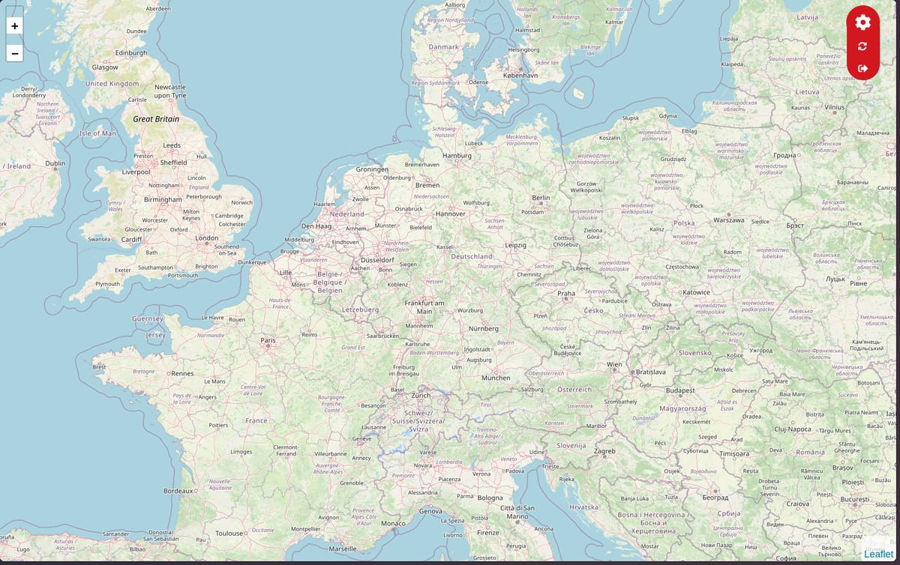
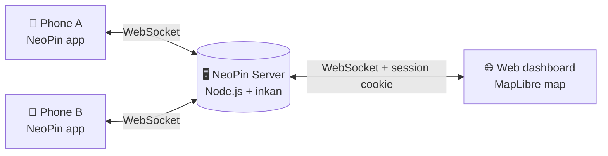

<div align="center">


<br>

Location sharing that runs on your own server instead of Google's.

[](https://expo.dev)
[](https://github.com/vxnsin/NeoPin/tree/Server)
[](LICENSE)

<br>



</div>

## How it works

Every phone runs the NeoPin app and connects to your server over a WebSocket, authenticated with a shared password. The server keeps the last known position of each device in memory and pushes every change to all connected apps and dashboards.



The app sends its position when it moves and answers when the server asks for a fresh one. On Android a foreground service keeps the connection alive in the background, on iOS the system wakes a background location task. How often positions are sent is up to you: battery saver, balanced or precise.

App and dashboard draw the same map, vector tiles from [OpenFreeMap](https://openfreemap.org) on MapLibre, light or dark with the system. Every device is a round picture or its initials, inside a ring that is green while it reports, yellow once its last position is older than ten minutes and grey when it is offline. Zoom in far enough and the names show under the pins. Next to every online device you see its battery, red when it runs low and green with a bolt while it charges. Like in Find My, the bar at the bottom opens the list of all devices, and the gear holds your profile picture, the update presets and the logout.

Nothing is written to disk and no third-party service sees your positions. Restart the server and everything is gone.

## Repository layout

The app and the server live in the same repository on different branches.

| Branch / tag | Contents |
|---|---|
| **`main`** | The React Native / Expo app. You are here. |
| [**`Server`**](https://github.com/vxnsin/NeoPin/tree/Server) | Node.js WebSocket server with the web dashboard. Has its own [README](https://github.com/vxnsin/NeoPin/blob/Server/README.md). |
| `archive/flutter` (tag) | The original Flutter app before the React Native rewrite. |

## Quick start

### 1. Run the server

The server lives on the `Server` branch and needs Node.js 22.18 or newer.

```bash
git clone -b Server https://github.com/vxnsin/NeoPin.git neopin-server
cd neopin-server
npm install
npm start
```

On first start a `.env` is created with `PORT=3012` and the default password `neopin123`. Change it right away, either in the file or with the `changePassword` console command. Docker setup and the HTTP API are in the [server README](https://github.com/vxnsin/NeoPin/blob/Server/README.md).

### 2. Run the app

```bash
git clone https://github.com/vxnsin/NeoPin.git
cd NeoPin
npm install
npx expo run:android   # or: npx pod-install && npx expo run:ios
```

The app uses native modules (background service, location, device info), so Expo Go won't do, you need a development build.

### 3. Connect

| Field | Example |
|---|---|
| Server address | `192.168.1.20:3012`, or `wss://neopin.example.com` behind a TLS proxy |
| Password | the `PASSWORD` from the server's `.env` |
| Name | any unique name, this is how the device shows up on the map |

The app remembers the login and connects on its own next time. Allow location access "all the time", otherwise updates stop as soon as the screen locks.

> Plain `ws://` is fine at home. Over the internet or on public Wi-Fi, put the server behind a TLS proxy and use `wss://`, otherwise the password and every position travel unencrypted.

## Build the app

Builds are configured in `eas.json`.

| Profile | Command | Output |
|---|---|---|
| `development` | `eas build --profile development` | Dev client for local testing |
| `preview` | `eas build --profile preview --platform android` | Installable APK |
| `production` | `eas build --profile production` | Store build, version is bumped automatically |

JavaScript changes can be shipped to installed apps with EAS Update, no new build needed.

## Push notifications (Android)

Push uses Firebase Cloud Messaging. It wakes the app when someone asks for a fresh position of an offline device, and shows notifications such as group invitations. Without the Firebase config the app builds and runs as before, it just gets no push.

1. Create a project in the [Firebase console](https://console.firebase.google.com) and add an Android app with the package name `de.vensin.neopin`.
2. Download `google-services.json` and either put it into the `app/` folder (it stays out of git, `.easignore` does not exclude it so EAS Build uploads it), or store it as an EAS file secret named `GOOGLE_SERVICES_JSON`.
3. Give the server the service account key of the same project (see the server docs), it sends the messages.
4. Build a new APK. Push needs the native Firebase setup, an EAS Update alone is not enough.

The server has to report `push: true` in `GET /api/status`, otherwise the app does not send its token.

## Protocol

All messages are JSON over a single WebSocket. The first message must authenticate.

**App → Server**

| Message | Purpose |
|---|---|
| `{ "type": "authenticate", "deviceId", "password" }` | Log in. Server replies `{ "successful": true }` or closes with code 4000. |
| `{ "type": "ping" }` | Keep-alive, answered with `pong`. |
| `{ "type": "pingDevices" }` | Ask the server to refresh every other device and return the full list. |
| `{ "type": "getData" }` | Return the cached device list without refreshing. |
| `{ "type": "updatePosition", "latitude", "longitude" }` | Report own position. |

**Server → App**

| Message | Purpose |
|---|---|
| `{ "type": "requestLocation", "from"? }` | Please send an `updatePosition` now. |
| `{ "type": "dataResponse", "devices": [...] }` | List of `{ deviceId, position, lastPing, status }`, pushed on every change. |
| `{ "type": "pong" }` | Keep-alive answer. |

## App structure

```
app/
├─ _layout.tsx        # socket provider, position reporter, background service toggle
├─ index.tsx          # intro on the first start, then auto-connect
├─ login.tsx          # server address / password / name form
├─ map.tsx            # map, device bar, device list and settings sheets
└─ error.tsx          # connection error screen with retry
components/           # Avatar, Field, Intro, PulseLogo, Footer
context/WebSocket.tsx # exposes the shared socket to screens
lib/
├─ SocketClient.ts    # reconnecting WebSocket client with heartbeat and queue
├─ socket.ts          # the one shared client instance + stored credentials
├─ mapHtml.ts         # the MapLibre page inside the WebView
├─ devices.ts         # status colours, initials, avatar colours
├─ avatar.ts          # pick, shrink and upload the profile picture
├─ logout.ts          # close the socket, stop background work, forget the login
├─ settings.ts        # position update presets
└─ time.ts            # "x min ago"
handlers/             # server message handlers, position reporting
hooks/                # useWebSocket, useAvatars, useAsyncStorage, usePermission, useThemeManager
services/             # Android foreground service
tasks/                # iOS background location task
themes/               # light and dark palettes
__tests__/            # Jest tests
```

`npm test` runs the tests for the socket client (login, reconnect, queue, heartbeat) against a fake WebSocket and for the profile picture upload.

## Roadmap

- [ ] Verify the background connection on real devices (Android foreground service, iOS background location)
- [ ] App screenshots for this page
- [ ] Publish builds: Play Store, F-Droid, GitHub Releases APK
- [ ] TLS setup guide for the server

## License

[MIT](LICENSE)

---

<div align="center">
<sub>Made by <a href="https://github.com/vxnsin">Vensin</a> · <a href="https://vensin.dev">vensin.dev</a></sub>
</div>
